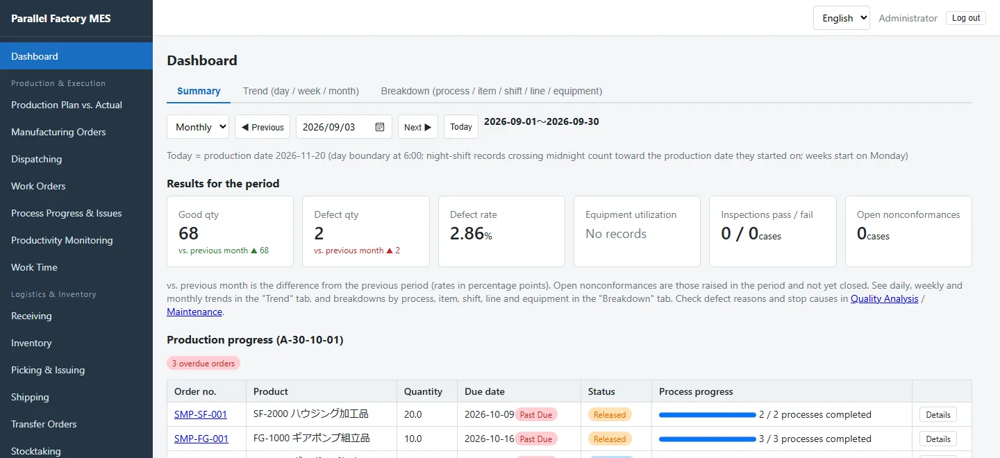

## What is Parallel Factory MES?

Parallel Factory MES is a manufacturing execution system (MES) for recording and tracing production in a factory. It runs in a web browser,
so you can use it directly from shop-floor PCs and tablets.

- **It manages the whole flow from manufacturing order to shipment.** Manufacturing order → work orders for each process → actuals → inventory → inspection → shipment judgment → shipment.
- **It traces everything by lot.** You can follow in both directions which material lots went into which product lots.
- **Every record keeps "who and when".** Corrections to actuals and inspections, master data changes, inventory operations and cancellations are recorded in the audit log, which you can view on the [Audit Log screen](security.html#audit-log) (system administrators only).

<a class="intro-banner" href="intro.html">
  
  <strong>Start with the overview page &rarr;</strong><small>A tour of the flow from manufacturing order to shipment and the main screens, with screenshots.</small>
</a>

To get a feel for the flow in motion, see [Factory model: from production to shipping](factory-tour.html). It shows, scene by scene across 15 scenes, which MES records change as goods move on the shop floor.

## How to use this guide

  <a href="getting-started.html"><strong>First-time users</strong><small>Starting the system, creating the initial administrator and signing in</small></a>
  <a href="masters.html"><strong>Implementation staff</strong><small>The master data to register first: processes, items, routings and more</small></a>
  <a href="execution.html"><strong>Operators</strong><small>Checking work orders, recording setups and entering actuals</small></a>
  <a href="logistics.html"><strong>Warehouse and logistics staff</strong><small>Receiving, inventory operations, issuing, shipping and stocktaking</small></a>
  <a href="quality.html"><strong>Quality control staff</strong><small>Inspection orders, results, judgments and nonconformances</small></a>
  <a href="assurance.html"><strong>Quality assurance staff</strong><small>Shipment judgments and lot traceability</small></a>

## The overall workflow

Right after installation, things go most smoothly in this order.

  Master data<em>→</em>
  Receiving (materials)<em>→</em>
  Manufacturing order<em>→</em>
  Release to processes<em>→</em>
  Dispatching<em>→</em>
  Setup<em>→</em>
  Actuals<em>→</em>
  Completion approval<em>→</em>
  Inspection<em>→</em>
  Shipment judgment<em>→</em>
  Shipping

| Step | Screen | Typical role | Details |
|---|---|---|---|
| Master data | Master Data | System administrator / Production management | [Master data](masters.html) |
| Receiving | Receiving | Logistics / warehouse | [Logistics and inventory](logistics.html) |
| Production plan and plan vs. actual | Production Plan vs. Actual | Production management | [Production management](production.html#plan) |
| Manufacturing orders, approval and release to processes | Manufacturing Orders | Production management | [Production management](production.html) |
| Dispatching, setup, actuals and completion approval | Dispatching / Work Orders | Production management / Operator | [Production execution](execution.html) |
| Inspection and nonconformances | Inspections / Nonconformances | Quality control | [Quality control](quality.html) |
| Shipment judgment and tracing | Shipment Judgments / Traceability | Quality assurance | [Quality assurance](assurance.html) |
| Shipping | Shipping | Logistics / warehouse | [Logistics and inventory](logistics.html) |
| Equipment and tools | Maintenance / Tool Management | Equipment maintenance | [Equipment maintenance and tools](maintenance.html) |

[Sample walkthrough: from production to shipping](walkthrough.html) follows this flow with diagrams and screenshots,
using the sample data (manufacturing and shipping 10 gear pumps).

## What this version can do

- Production management (receiving production plans and comparing plan with actual, manufacturing orders, release to processes, progress)
- Production execution (dispatching, setups, checklists, actuals, trouble reports)
- Logistics and inventory (receiving, inventory operations, issuing, shipping, stocktaking)
- Quality control (inspection orders, results, judgments, nonconformances)
- Quality assurance (shipment judgments, traceability)
- Equipment maintenance (operation records, maintenance plans, orders and results, procedures) and tool life management
- Report and label printing, barcode / QR code scanning
- A choice of database: SQLite (default), PostgreSQL or SQL Server
- Three ways to install: the Microsoft Store edition (for trying it on one PC), ZIP (Windows / Linux) and Docker ([Installation and initial setup](getting-started.html))

To look up <strong>what a term or status means</strong>, see the <a href="reference.html">Reference</a>.
If <strong>an error stops you from continuing</strong>, see <a href="troubleshooting.html">Troubleshooting</a>.

## Supporting development

Parallel Factory MES is developed by an individual. Donations to keep development going are welcome through
[GitHub Sponsors](https://github.com/sponsors/msmsrep) and [Ko-fi](https://ko-fi.com/msmsrep).
Donations do not add features or remove limits; every feature remains free to use, as it always has been.
