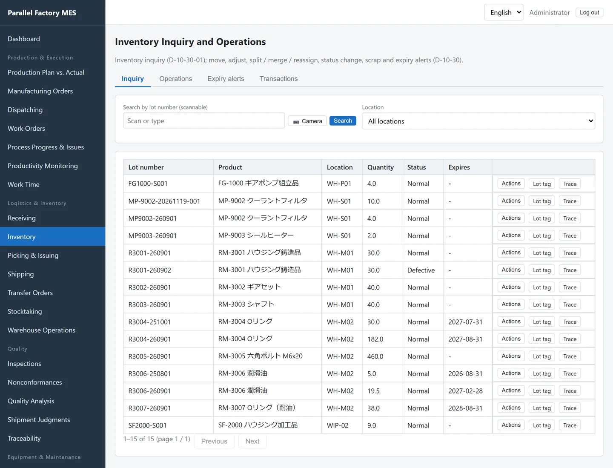
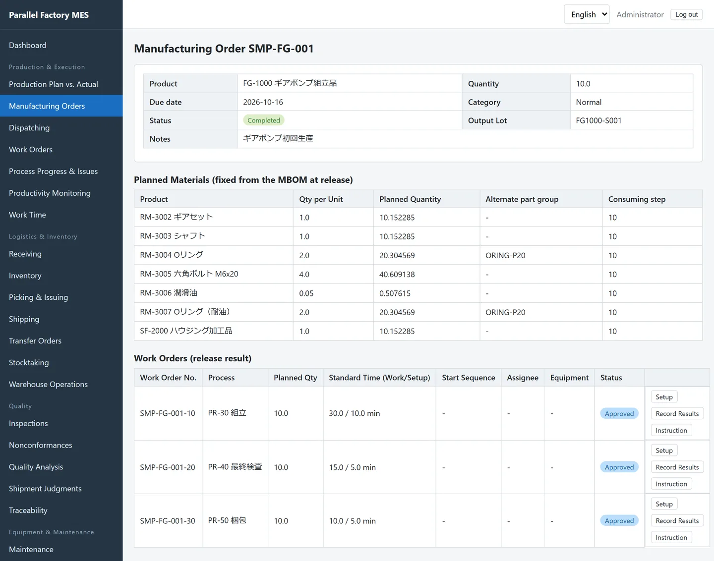
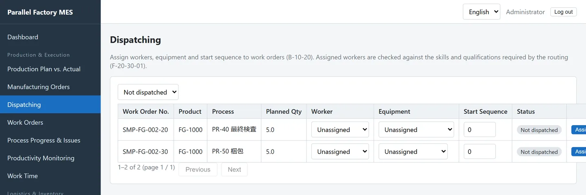
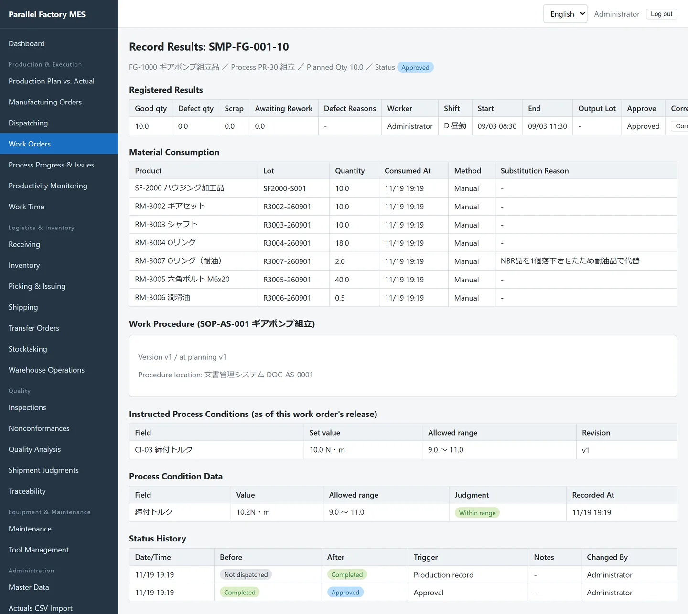
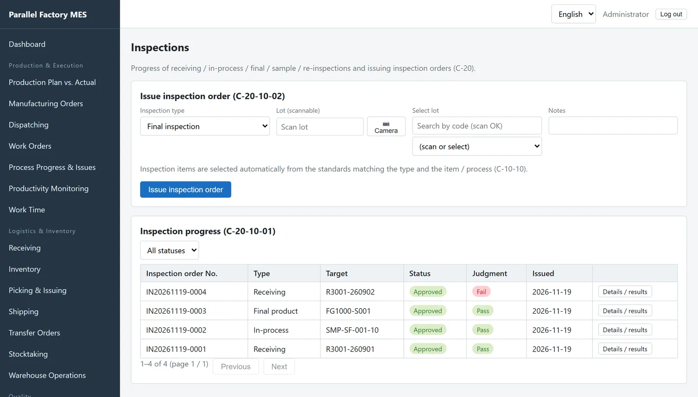
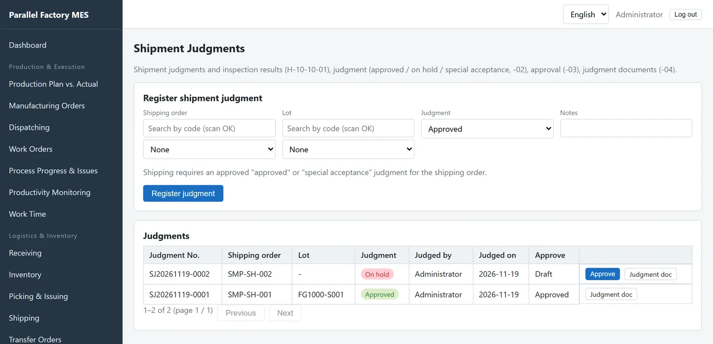
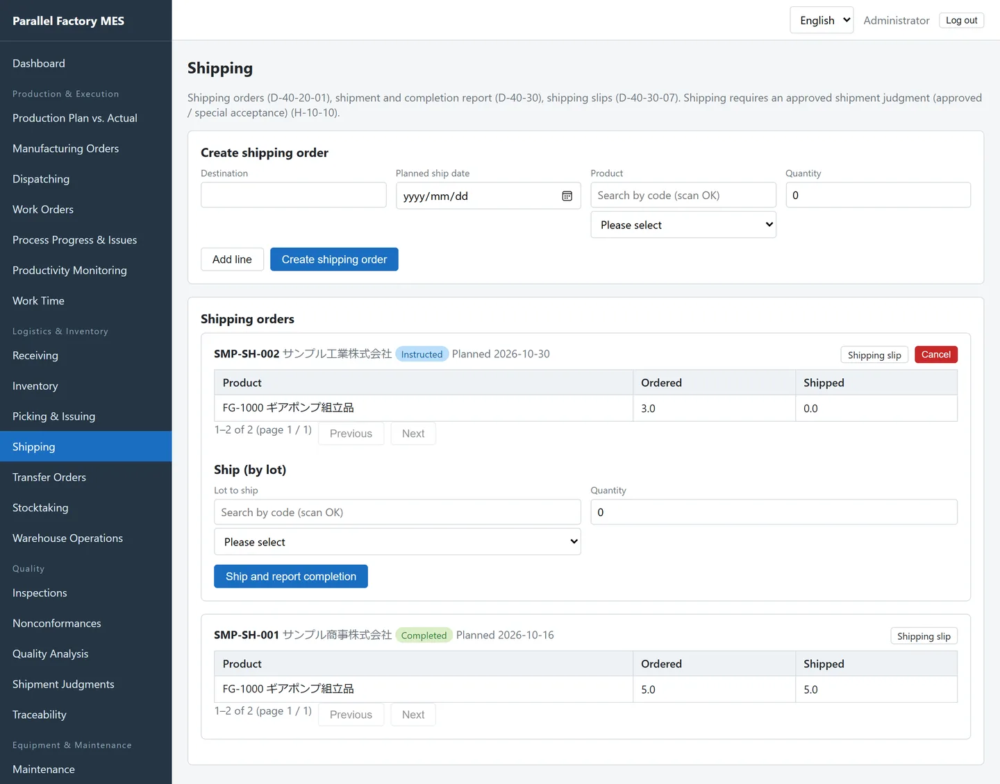
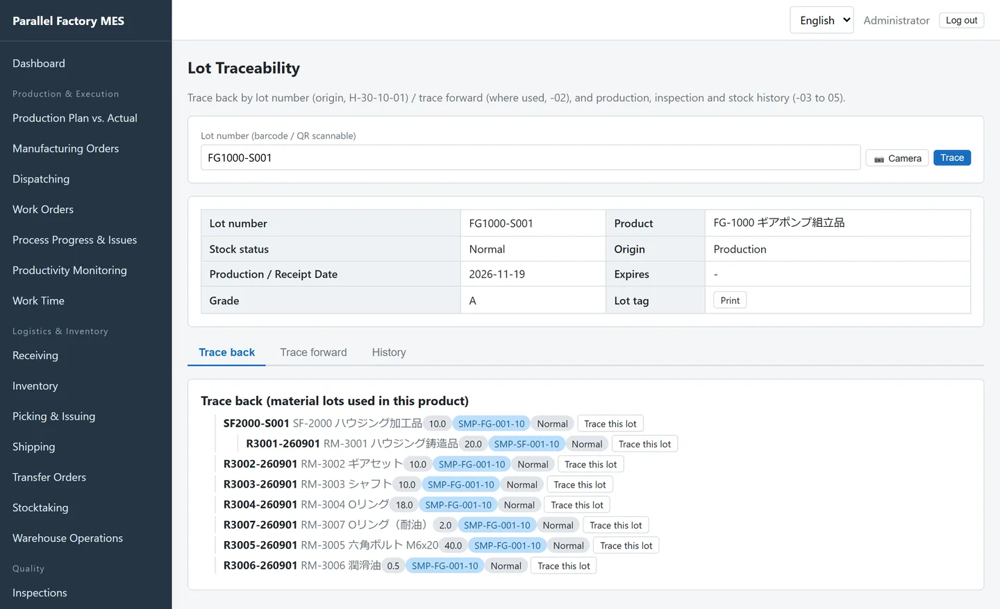

To get a feel for the flow in motion first, see [Factory model: from production to shipping](factory-tour.html). This page is its detailed companion.

<strong>You can reproduce everything on this page yourself.</strong>
Put the CSVs in <code>samples/master-csv</code> and <code>samples/actual-csv</code> into one ZIP each,
and import the master data and then the actuals with <strong>Bulk import via ZIP</strong> at the top of the screen.
Operations not included in the CSVs (completion approval, inspection approval and so on) are listed in <a href="#try">the last section</a>.

The sample data values (product names, people's names, customers and so on) are in Japanese, so they appear in Japanese in the screenshots. This page gives them in English, together with their codes.

## 1. The overall flow  {#overview}

The subject followed here is **manufacturing order SMP-FG-001, which makes 10 FG-1000 gear pumps**.
The housing, the outer part of the gear pump, is made by the upstream **manufacturing order SMP-SF-001**, which machines a casting and gives it a surface treatment.

From receiving components to shipping, there are the following 10 stages. The roles in charge are separated into horizontal bands (lanes) in the diagram.

<figure class="fig">

<svg viewBox="0 0 960 296" role="img" aria-label="The 10 stages from receiving to shipping and the roles in charge">
<defs><marker id="a1" viewBox="0 0 10 10" refX="9" refY="5" markerWidth="7" markerHeight="7" orient="auto-start-reverse"><path class="head" d="M0 0L10 5L0 10z"/></marker></defs>
<rect class="lane" x="0" y="10" width="960" height="64"/>
<rect class="lane" x="0" y="150" width="960" height="64"/>
<text class="tb" x="14" y="38">Production</text><text class="m" x="14" y="56">pm001</text>
<text class="tb" x="14" y="108">Logistics</text><text class="m" x="14" y="126">lg001</text>
<text class="tb" x="14" y="178">Operators</text><text class="m" x="14" y="196">op001–003</text>
<text class="tb" x="14" y="248">Quality</text><text class="m" x="14" y="266">qc001</text>
<g text-anchor="middle">
<rect class="lg" x="120" y="90" width="70" height="44" rx="6"/><text class="m" x="126" y="87" text-anchor="start">1</text><text class="t" x="155" y="109">Receive</text><text class="m" x="155" y="125">lots</text>
<rect class="pm" x="202" y="20" width="70" height="44" rx="6"/><text class="m" x="208" y="17" text-anchor="start">2</text><text class="t" x="237" y="39">Order</text><text class="m" x="237" y="55">approve</text>
<rect class="pm" x="284" y="20" width="70" height="44" rx="6"/><text class="m" x="290" y="17" text-anchor="start">3</text><text class="t" x="319" y="39">Release</text><text class="m" x="319" y="55">to WOs</text>
<rect class="pm" x="366" y="20" width="70" height="44" rx="6"/><text class="m" x="372" y="17" text-anchor="start">4</text><text class="t" x="401" y="39">Dispatch</text><text class="m" x="401" y="55">staff, equip.</text>
<rect class="op" x="448" y="160" width="70" height="44" rx="6"/><text class="m" x="454" y="157" text-anchor="start">5</text><text class="t" x="483" y="179">Setup</text><text class="m" x="483" y="195">checks</text>
<rect class="op" x="530" y="160" width="70" height="44" rx="6"/><text class="m" x="536" y="157" text-anchor="start">6</text><text class="t" x="565" y="179">Results</text><text class="m" x="565" y="195">good, defect</text>
<rect class="pm" x="612" y="20" width="70" height="44" rx="6"/><text class="m" x="618" y="17" text-anchor="start">7</text><text class="t" x="647" y="39">Approve</text><text class="m" x="647" y="55">finalize</text>
<rect class="qc" x="694" y="230" width="70" height="44" rx="6"/><text class="m" x="700" y="227" text-anchor="start">8</text><text class="t" x="729" y="249">Inspect</text><text class="m" x="729" y="265">pass / fail</text>
<rect class="qc" x="776" y="230" width="70" height="44" rx="6"/><text class="m" x="782" y="227" text-anchor="start">9</text><text class="t" x="811" y="249">Judgment</text><text class="m" x="811" y="265">approve</text>
<rect class="lg" x="858" y="90" width="70" height="44" rx="6"/><text class="m" x="864" y="87" text-anchor="start">10</text><text class="t" x="893" y="109">Ship</text><text class="m" x="893" y="125">deduct stock</text>
</g>
<g class="ln" marker-end="url(#a1)">
<path d="M190 112H196V42H201"/><path d="M272 42H283"/><path d="M354 42H365"/><path d="M436 42H442V182H447"/>
<path d="M518 182H529"/><path d="M600 182H606V42H611"/><path d="M682 42H688V252H693"/><path d="M764 252H775"/><path d="M846 252H852V112H857"/>
</g>
</svg>

<figcaption>Figure 1. The 10 stages and the role in charge of each</figcaption>
</figure>

Production managementLogistics / warehouseOperatorQuality control / assurance

| # | Stage | Screen used | Example on this page |
|---|---|---|---|
| 1 | Receiving | Logistics & Inventory → Receiving | 50 castings in lot R3001-260901 |
| 2–3 | Manufacturing order and release to processes | Production & Execution → Manufacturing Orders | SMP-FG-001 (10 units) → 3 work orders |
| 4 | Dispatching | Production & Execution → Dispatching | Assigning a worker and equipment to the work orders of SMP-FG-002 |
| 5–6 | Setup and recording results | Work Orders → Setup / Record Results | 10 units assembled; 9 good and 1 defective at packing |
| 7 | Completion approval | Record Results (Approve Production Completion) | The 3 work orders become "Approved" |
| 8 | Inspection | Quality → Inspections | Final inspection: flow rate 20.3 L/min, pass |
| 9 | Shipment judgment | Quality → Shipment Judgments | Judged "Approved", and the judgment approved |
| 10 | Shipping | Logistics & Inventory → Shipping | 5 units to the customer Sample Trading |

---

## 2. The factory and the people  {#plant}

The sample has one factory, **Plant 1 (PL-1)**. It consists of four levels: factory → line → area → work center,
and each piece of equipment, storage location and worker belongs to one of these levels.

<figure class="fig">

<svg viewBox="0 0 960 372" role="img" aria-label="The work center hierarchy, and the equipment, locations and workers that belong to it">
<text class="m" x="8" y="42">Plant</text><text class="m" x="8" y="122">Line</text><text class="m" x="8" y="202">Area</text><text class="m" x="8" y="276">Work ctr</text>
<g class="ln"><path d="M480 60V78"/><path d="M150 78H740"/><path d="M150 78V96"/><path d="M400 78V96"/><path d="M740 78V96"/>
<path d="M150 140V176"/><path d="M400 140V176"/><path d="M740 140V158H640V176"/><path d="M740 158H840V176"/>
<path d="M150 220V250"/><path d="M400 220V250"/><path d="M640 220V250"/><path d="M840 220V250"/></g>
<g text-anchor="middle">
<rect class="box" x="390" y="14" width="180" height="46" rx="8"/><text class="tb" x="480" y="35">Plant 1</text><text class="m" x="480" y="51">PL-1</text>
<rect class="box" x="70" y="96" width="160" height="44" rx="8"/><text class="tb" x="150" y="116">Machining line</text><text class="m" x="150" y="132">LN-MC</text>
<rect class="box" x="320" y="96" width="160" height="44" rx="8"/><text class="tb" x="400" y="116">Assembly line</text><text class="m" x="400" y="132">LN-AS</text>
<rect class="box" x="660" y="96" width="160" height="44" rx="8"/><text class="tb" x="740" y="116">Logistics, quality</text><text class="m" x="740" y="132">LN-LG</text>
<rect class="box" x="70" y="176" width="160" height="44" rx="8"/><text class="tb" x="150" y="196">Machining area</text><text class="m" x="150" y="212">AR-MC</text>
<rect class="box" x="320" y="176" width="160" height="44" rx="8"/><text class="tb" x="400" y="196">Assembly area</text><text class="m" x="400" y="212">AR-AS</text>
<rect class="box" x="560" y="176" width="160" height="44" rx="8"/><text class="tb" x="640" y="196">Inspection room</text><text class="m" x="640" y="212">AR-QC</text>
<rect class="box" x="760" y="176" width="160" height="44" rx="8"/><text class="tb" x="840" y="196">Shipping area</text><text class="m" x="840" y="212">AR-SH</text>
<rect class="op" x="70" y="250" width="160" height="44" rx="8"/><text class="tb" x="150" y="270">CNC machining</text><text class="m" x="150" y="286">WC-MC1</text>
<rect class="op" x="320" y="250" width="160" height="44" rx="8"/><text class="tb" x="400" y="270">Pump assembly</text><text class="m" x="400" y="286">WC-AS1</text>
<rect class="qc" x="560" y="250" width="160" height="44" rx="8"/><text class="tb" x="640" y="270">Final inspection</text><text class="m" x="640" y="286">WC-QC1</text>
<rect class="op" x="760" y="250" width="160" height="44" rx="8"/><text class="tb" x="840" y="270">Packing</text><text class="m" x="840" y="286">WC-PK1</text>
<text class="m" x="150" y="316">Equipment EQ-01, EQ-05</text><text class="m" x="150" y="334">Location WIP-01</text><text class="m c-op" x="150" y="352">op001 (day), op003 (night)</text>
<text class="m" x="400" y="316">Equipment EQ-02</text><text class="m" x="400" y="334">Location WIP-02</text><text class="m c-op" x="400" y="352">op002</text>
<text class="m" x="640" y="316">EQ-03 (CMM)</text><text class="m c-qc" x="640" y="334">qc001</text>
<text class="m" x="840" y="316">EQ-04 (vacuum packer)</text><text class="m" x="840" y="334">Location SHIP-01</text><text class="m c-lg" x="840" y="352">lg001 (shipping area)</text>
</g>
<text class="m" x="590" y="28">Locations  WH-M01, WH-M02 (material warehouse)</text>
<text class="m" x="590" y="44">           WH-S01 (spare parts), WH-P01 (product warehouse)</text>
<text class="m" x="590" y="60">People     pm001 production, mt001 maintenance</text>
</svg>

<figcaption>Figure 2. The work center hierarchy (Master Data → Work center) and the equipment, locations and workers belonging to each level</figcaption>
</figure>

| User | Role | Part on this page |
|---|---|---|
| pm001 | Production management | Registering, approving and releasing manufacturing orders, dispatching, completion approval |
| lg001 | Logistics | Receiving components, shipping orders and shipping |
| op001 / op003 | Operator | Machining the housing (op003 works the night shift). op001 also enters results for the final inspection of the gear pump |
| op002 | Operator | Assembling and packing the gear pump |
| qc001 | Quality control / quality assurance | Inspection, shipment judgment |

There are two shifts: **day shift D (8:00–17:00)** and **night shift N (20:00–5:00 the next day)**, which crosses midnight.
The shift of an actual is decided by its start time.
For details, see [Master data](masters.html).

---

## 3. What is made, and how  {#product}

The FG-1000 gear pump is assembled from the in-house machined housing SF-2000 and five purchased components.
The parent–child relationships between products are called the **MBOM (bill of materials)**, and the sequence of processes the **routing**.

<figure class="fig">

<svg viewBox="0 0 960 380" role="img" aria-label="Bill of materials and routings of SF-2000 and FG-1000">
<defs><marker id="a3" viewBox="0 0 10 10" refX="9" refY="5" markerWidth="7" markerHeight="7" orient="auto-start-reverse"><path class="head" d="M0 0L10 5L0 10z"/></marker></defs>
<text class="tb" x="20" y="24">Making the machined housing SF-2000 (manufacturing order SMP-SF-001, 20 pcs)</text>
<g text-anchor="middle">
<rect class="card" x="20" y="40" width="150" height="56" rx="8"/><text class="tb" x="95" y="62">RM-3001</text><text class="t" x="95" y="82">Housing casting</text>
<rect class="op" x="210" y="40" width="160" height="56" rx="8"/><text class="tb" x="290" y="62">PR-10 Machining</text><text class="m" x="290" y="82">WC-MC1, std. 25 min</text>
<rect class="op dash" x="400" y="40" width="160" height="56" rx="8"/><text class="tb" x="480" y="62">PR-20 Surface</text><text class="m" x="480" y="82">Outsourced (anodizing)</text>
<rect class="card" x="600" y="40" width="160" height="56" rx="8"/><text class="tb" x="680" y="62">SF-2000</text><text class="t" x="680" y="82">Machined housing</text>
<text class="m c-qc" x="95" y="116">Receiving insp. INS-03</text>
<text class="m c-qc" x="290" y="116">In-process insp. INS-01, 02</text><text class="m" x="290" y="132">Conditions: spindle speed, feed</text>
<text class="m" x="480" y="116">Done at the subcontractor</text>
</g>
<g class="ln" marker-end="url(#a3)"><path d="M170 68H206"/><path d="M370 68H396"/><path d="M560 68H596"/><path d="M760 68H790V176H155V185"/></g>
<text class="tb" x="20" y="164">Making the FG-1000 gear pump (manufacturing order SMP-FG-001, 10 units)</text>
<rect class="card" x="20" y="186" width="270" height="180" rx="8"/>
<text class="tb" x="34" y="208">MBOM (per unit)</text>
<text class="t" x="34" y="232">SF-2000 machined housing ×1</text>
<text class="t" x="34" y="252">RM-3002 gear set ×1</text>
<text class="t" x="34" y="272">RM-3003 shaft ×1</text>
<text class="t" x="34" y="292">RM-3004 O-ring ×2</text>
<text class="m" x="46" y="310">└ alternate RM-3007 O-ring (oil-resistant)</text>
<text class="t" x="34" y="332">RM-3005 hex bolt M6x20 ×4</text>
<text class="t" x="34" y="352">RM-3006 lubricant ×0.05 L</text>
<g text-anchor="middle">
<rect class="op" x="330" y="248" width="150" height="56" rx="8"/><text class="tb" x="405" y="270">PR-30 Assembly</text><text class="m" x="405" y="290">WC-AS1, std. 30 min</text>
<rect class="qc" x="510" y="248" width="150" height="56" rx="8"/><text class="tb" x="585" y="270">PR-40 Final insp.</text><text class="m" x="585" y="290">WC-QC1, std. 15 min</text>
<rect class="op" x="690" y="248" width="130" height="56" rx="8"/><text class="tb" x="755" y="270">PR-50 Packing</text><text class="m" x="755" y="290">WC-PK1, std. 10 min</text>
<rect class="card" x="850" y="248" width="100" height="56" rx="8"/><text class="tb" x="900" y="270">FG-1000</text><text class="t" x="900" y="290">Gear pump</text>
<text class="m" x="405" y="324">Condition: torque</text><text class="m" x="405" y="340">Checklist CL-02</text>
<text class="m c-qc" x="585" y="324">Final insp. INS-04, 05</text><text class="m" x="585" y="340">Condition: test pressure</text>
<text class="m" x="755" y="324">Checklist CL-03</text>
<text class="m" x="900" y="324">Put away WH-P01</text>
</g>
<g class="ln" marker-end="url(#a3)"><path d="M290 276H326"/><path d="M480 276H506"/><path d="M660 276H686"/><path d="M820 276H846"/></g>
</svg>

<figcaption>Figure 3. Bill of materials (MBOM) and routings. Dashed boxes are outsourced processes; purple text marks when inspections happen</figcaption>
</figure>

- **The O-ring has an alternate part.** RM-3004 (NBR) is normally used, but RM-3007 (oil-resistant FKM) in the same alternate group `ORING-P20` can be used instead.
- **Each process of the routing is linked to a work center, candidate equipment, tools, required skills, checklists and manufacturing conditions.** For example, PR-10 uses the machining centers (EQ-01 / EQ-05), the end mill TL-01, the skill SK-01 "machining center operation" and the pre-start checklist CL-01.
- The good units of the final process (PR-50 packing for FG-1000) go into inventory as the product lot.

For how to register MBOMs and routings, see [Products, MBOM & Routings in Master data](masters.html).

---

## 4. Receiving components  {#receiving}

**In charge: Logistics (lg001)　Screen: Logistics & Inventory → Receiving**

Components delivered by suppliers are registered in the warehouse as **lots**. All later inventory, consumption and tracing are connected by this lot number.

<figure class="fig">

<svg viewBox="0 0 960 326" role="img" aria-label="Received component lots and their locations">
<defs><marker id="a4" viewBox="0 0 10 10" refX="9" refY="5" markerWidth="7" markerHeight="7" orient="auto-start-reverse"><path class="head" d="M0 0L10 5L0 10z"/></marker></defs>
<rect class="lg" x="10" y="124" width="140" height="80" rx="8"/>
<g text-anchor="middle"><text class="tb" x="80" y="152">Receiving</text><text class="m" x="80" y="170">registered by lg001</text><text class="m" x="80" y="186">screen / CSV</text></g>
<g class="ln" marker-end="url(#a4)"><path d="M150 164H165V58H177"/><path d="M150 164H177"/><path d="M165 164V270H177"/></g>
<rect class="box" x="180" y="10" width="770" height="96" rx="8"/><text class="tb" x="194" y="32">WH-M01  Material warehouse (shelf A-01-01)</text>
<rect class="box" x="180" y="116" width="770" height="96" rx="8"/><text class="tb" x="194" y="138">WH-M02  Material warehouse (shelf A-01-02)</text>
<rect class="box" x="180" y="222" width="770" height="96" rx="8"/><text class="tb" x="194" y="244">WH-S01  Spare parts shelf (shelf M-01-01)</text>
<rect class="card" x="194" y="42" width="175" height="56" rx="6"/><text class="tb" x="204" y="60">R3001-260901</text><text class="m" x="204" y="76">Housing casting, 50 pcs</text>
<rect class="card" x="379" y="42" width="175" height="56" rx="6"/><text class="tb" x="389" y="60">R3002-260901</text><text class="m" x="389" y="76">Gear set, 50 sets</text>
<rect class="card" x="564" y="42" width="175" height="56" rx="6"/><text class="tb" x="574" y="60">R3003-260901</text><text class="m" x="574" y="76">Shaft, 50 pcs</text>
<rect class="qc" x="749" y="42" width="190" height="56" rx="6"/><text class="tb" x="759" y="60">Receiving insp. INS-03</text><text class="m" x="759" y="76">R3001 appearance → pass</text><text class="m" x="759" y="91">No voids or chips</text>
<rect class="card" x="194" y="148" width="175" height="56" rx="6"/><text class="tb" x="204" y="166">R3004-260901</text><text class="m" x="204" y="182">O-ring, 200 pcs</text><text class="m" x="204" y="197">Expires 2027-08-31</text>
<rect class="card" x="379" y="148" width="175" height="56" rx="6"/><text class="tb" x="389" y="166">R3007-260901</text><text class="m" x="389" y="182">Oil-resistant O-ring, 40</text><text class="m" x="389" y="197">Exp. 2028-08-31, alternate</text>
<rect class="card" x="564" y="148" width="175" height="56" rx="6"/><text class="tb" x="574" y="166">R3005-260901</text><text class="m" x="574" y="182">Hex bolt, 500 pcs</text>
<rect class="card" x="749" y="148" width="175" height="56" rx="6"/><text class="tb" x="759" y="166">R3006-260901</text><text class="m" x="759" y="182">Lubricant, 20 L</text><text class="m" x="759" y="197">Expires 2027-02-28</text>
<rect class="card" x="194" y="254" width="250" height="56" rx="6"/><text class="tb" x="204" y="272">MP-9002-(receipt date)-001</text><text class="m" x="204" y="288">Coolant filter, 10 pcs</text><text class="m" x="204" y="303">Blank lot number = assigned automatically</text>
</svg>

<figcaption>Figure 4. Where the received component lots are kept. Rubber products and lubricant have expiry dates</figcaption>
</figure>

- **You may specify a lot number or leave it blank to have one assigned automatically.** The sample specifies numbers for lots that are consumed later (`R3001-260901` and so on).
- Lots with an **expiry date** appear in the **Expiry alerts** of the inventory screen as the date approaches. Expired lots can be neither consumed nor shipped.
- The castings are checked by a **receiving inspection** (INS-03, visual). The inspection flow is explained in [section 7](#inspection).

<figure class="shot">

<figcaption>Inventory (Logistics & Inventory → Inventory). This screenshot shows the state after importing only <code>01</code>–<code>15</code> of the actuals CSVs and finishing shipping: 20 of the 50 castings in R3001-260901 have been used, leaving 30. Spare parts and an additional delivery received at the same time are also listed, and R3001-260902 shows "Defective" because it failed its receiving inspection. MP-9002, whose lot number was not specified, gets a number based on the day it was imported. If you import all the samples, the inventory operations from <code>16</code> onward change the quantities (for example, the castings become 31 after a return from issue, and the gear pumps 3 after retained samples)</figcaption>
</figure>

For details, see [Receiving in Logistics and inventory](logistics.html#receiving).

---

## 5. From manufacturing order to work orders  {#order}

**In charge: Production management (pm001)　Screen: Production & Execution → Manufacturing Orders / Dispatching**

"What to make, how many, and by when" is registered as a **manufacturing order**. Once it is approved and **released to processes**,
a **work order** is created for each process along the routing.

<figure class="fig">

<svg viewBox="0 0 960 414" role="img" aria-label="A manufacturing order splitting into a work order for each process, and how their statuses change">
<defs><marker id="a5" viewBox="0 0 10 10" refX="9" refY="5" markerWidth="7" markerHeight="7" orient="auto-start-reverse"><path class="head" d="M0 0L10 5L0 10z"/></marker></defs>
<rect class="pm" x="20" y="40" width="230" height="130" rx="8"/>
<text class="tb" x="36" y="66">Mfg. order SMP-FG-001</text>
<text class="t" x="36" y="90">FG-1000 gear pump ×10</text>
<text class="t" x="36" y="112">Due 2026-10-16</text>
<text class="m" x="36" y="136">Registered and approved by pm001</text>
<text class="m" x="36" y="154">(Approve and Expand columns in CSV)</text>
<text class="m" x="274" y="97" text-anchor="middle">Release</text>
<g class="ln" marker-end="url(#a5)"><path d="M250 105H300V50H326"/><path d="M300 105H326"/><path d="M300 105V160H326"/></g>
<rect class="op" x="330" y="30" width="280" height="40" rx="6"/><text class="tb" x="344" y="55">SMP-FG-001-10</text><text class="t" x="470" y="55">PR-30 Assembly, 10</text>
<rect class="op" x="330" y="85" width="280" height="40" rx="6"/><text class="tb" x="344" y="110">SMP-FG-001-20</text><text class="t" x="470" y="110">PR-40 Final insp., 10</text>
<rect class="op" x="330" y="140" width="280" height="40" rx="6"/><text class="tb" x="344" y="165">SMP-FG-001-30</text><text class="t" x="470" y="165">PR-50 Packing, 10</text>
<rect class="card" x="650" y="30" width="290" height="50" rx="6"/><text class="tb" x="664" y="52">Output lot FG1000-S001</text><text class="m" x="664" y="70">Good units of the final process go in as this lot</text>
<rect class="card" x="650" y="92" width="290" height="88" rx="6"/><text class="tb" x="664" y="114">Planned materials (MBOM×10÷(1−1.5%))</text>
<text class="m" x="664" y="134">SF-2000 10.15, gear set 10.15, shaft 10.15</text>
<text class="m" x="664" y="152">O-ring 20.30 (alternate OK), bolt 40.61, oil 0.51 L</text>
<text class="m" x="664" y="170">Products not planned cannot be consumed</text>
<text class="tb" x="20" y="250">Manufacturing order status</text>
<g text-anchor="middle">
<rect class="card" x="20" y="264" width="110" height="34" rx="17"/><text class="t" x="75" y="286">Draft</text>
<rect class="pm" x="230" y="264" width="110" height="34" rx="17"/><text class="t" x="285" y="286">Approved</text>
<rect class="pm" x="440" y="264" width="110" height="34" rx="17"/><text class="t" x="495" y="286">Released</text>
<rect class="op" x="650" y="264" width="110" height="34" rx="17"/><text class="t" x="705" y="286">Completed</text>
<text class="m c-pm" x="180" y="274">Approve</text><text class="m c-pm" x="390" y="274">Release</text><text class="m c-pm" x="600" y="274">All approved</text>
</g>
<g class="ln" marker-end="url(#a5)"><path d="M130 284H226"/><path d="M340 284H436"/><path d="M550 284H646"/></g>
<text class="tb" x="20" y="336">Work order status</text>
<g text-anchor="middle">
<rect class="card" x="20" y="350" width="110" height="34" rx="17"/><text class="t" x="75" y="372">Not dispatched</text>
<rect class="pm" x="195" y="350" width="110" height="34" rx="17"/><text class="t" x="250" y="372">Dispatched</text>
<rect class="op" x="370" y="350" width="110" height="34" rx="17"/><text class="t" x="425" y="372">Started</text>
<rect class="op" x="545" y="350" width="110" height="34" rx="17"/><text class="t" x="600" y="372">Completed</text>
<rect class="pm" x="720" y="350" width="110" height="34" rx="17"/><text class="t" x="775" y="372">Approved</text>
<text class="m c-pm" x="162" y="360">Dispatch</text><text class="m c-op" x="337" y="360">Start</text><text class="m c-op" x="512" y="360">Results</text><text class="m c-pm" x="687" y="360">Approve</text>
</g>
<g class="ln" marker-end="url(#a5)"><path d="M130 370H191"/><path d="M305 370H366"/><path d="M480 370H541"/><path d="M655 370H716"/></g>
<text class="m" x="20" y="406">* Work can be started while still "Not dispatched", without dispatching.</text>
</svg>

<figcaption>Figure 5. Release to processes creates 3 work orders and fixes the output lot and planned materials (top). The statuses of the order and the work orders (bottom)</figcaption>
</figure>

<figure class="shot">

<figcaption>Manufacturing order details. The planned materials and the work orders created by release to processes are listed. The planned quantities are increased by the gear pump's standard defect rate of 1.5%, and every component is used in assembly (step 10). From each row you can go on to setup, result entry and printing the instruction</figcaption>
</figure>

In **dispatching**, a worker, equipment and start sequence are assigned to each work order. The worker is checked against the skills required by the routing,
and people without the skill, or whose qualification has expired, cannot be assigned (for example, PR-30 assembly requires the skill SK-04 "assembly work").

<figure class="shot">

<figcaption>The Dispatching screen. In the sample, you can try releasing SMP-FG-002 (approved but not released) from the screen. This screenshot was taken after assigning -10 to op002 and EQ-02, and the other 2 work orders are listed as "Not dispatched"</figcaption>
</figure>

For details, see [Production management](production.html) and [Dispatching in Production execution](execution.html).

---

## 6. Making it on the shop floor  {#execution}

**In charge: Operators (op001–003)　Screen: Work Orders → Setup / Record Results**

Workers open a work order, do the setup and checks, start the work, and record the component lots used and the output.
In the sample, the housings are machined on the night shift of 9/1, surface-treated by a subcontractor on 9/2, and the gear pumps assembled on the day shift of 9/3.

<figure class="fig">

<svg viewBox="0 0 960 324" role="img" aria-label="The timeline of work from the night of September 1 to September 3, and the handover of lots">
<defs><marker id="a6" viewBox="0 0 10 10" refX="9" refY="5" markerWidth="7" markerHeight="7" orient="auto-start-reverse"><path class="head" d="M0 0L10 5L0 10z"/></marker></defs>
<rect class="lane" x="140" y="32" width="240" height="264"/>
<g text-anchor="middle"><text class="tb" x="260" y="22">9/1–9/2  Night shift N</text><text class="tb" x="475" y="22">9/2  Day shift D</text><text class="tb" x="675" y="22">9/3  Day shift D</text></g>
<g class="ln dash"><path d="M390 32V296"/><path d="M560 32V296"/></g>
<text class="tb" x="10" y="56">WC-MC1</text><text class="m" x="10" y="72">Machining</text>
<text class="tb" x="10" y="108">Outsourced</text><text class="m" x="10" y="124">Surface</text>
<text class="tb" x="10" y="160">WC-AS1</text><text class="m" x="10" y="176">Assembly</text>
<text class="tb" x="10" y="212">WC-QC1</text><text class="m" x="10" y="228">Final insp.</text>
<text class="tb" x="10" y="264">WC-PK1</text><text class="m" x="10" y="280">Packing</text>
<rect class="box" x="155" y="46" width="10" height="22" rx="3"/>
<rect class="op" x="170" y="46" width="180" height="22" rx="4"/><text class="t" x="178" y="62">PR-10 Machining  good 20</text>
<text class="m c-ng" x="170" y="84">Feed 1350 out of tolerance (deviation)</text>
<rect class="op dash" x="415" y="98" width="120" height="22" rx="4"/><text class="t" x="423" y="114">PR-20 Surface</text>
<text class="m" x="415" y="136">good 19, defect 1 (void)</text>
<path class="ln dash" marker-end="url(#a6)" d="M535 109C562 109 574 161 596 161"/>
<rect class="box" x="585" y="150" width="5" height="22" rx="2"/>
<rect class="op" x="600" y="150" width="90" height="22" rx="4"/><text class="t" x="607" y="166">PR-30 Assy</text>
<text class="m" x="585" y="188">good 10, 2 alternate O-rings consumed</text>
<rect class="qc" x="720" y="202" width="15" height="22" rx="4"/><text class="m" x="741" y="218">PR-40 Final insp.  good 10</text>
<rect class="op" x="750" y="254" width="15" height="22" rx="4"/><rect class="box" x="765" y="254" width="10" height="22" rx="3"/>
<text class="m" x="781" y="270">PR-50 Packing  good 9, defect 1</text>
<text class="m" x="585" y="292">→ 9 units of FG1000-S001 put away in WH-P01</text>
<g class="m" text-anchor="middle"><text x="140" y="312">20:00</text><text x="260" y="312">0:00</text><text x="380" y="312">4:00</text><text x="415" y="312">8:00</text><text x="535" y="312">12:00</text><text x="585" y="312">8:00</text><text x="705" y="312">12:00</text></g>
</svg>

<figcaption>Figure 6. The flow of work over three days. The small gray boxes are setups. The dashed arrow shows the semi-finished lot SF2000-S001 (19 pcs, WIP-02) made by surface treatment being used in assembly</figcaption>
</figure>

Work (actuals)Inspection processDeviation / defect

The following are recorded for one work order. All of them are entered on the **result entry screen** (work order list → Record Results).

| Record | Sample example | Meaning |
|---|---|---|
| Setup | Pre-setup of SMP-SF-001-10, 20:30–20:50 | The time taken for setup, and any abnormalities |
| Checklist | CL-01 pre-start check (removing chips is an optional item and left unchecked) | It cannot be registered while a required item is unchecked |
| Material consumption | 10 of SF2000-S001, 18 of R3004 and 2 of the alternate R3007 consumed in SMP-FG-001-10 | Which lots were used and how many. **Products not in the planned materials cannot be consumed.** Alternates require a reason |
| Process condition data | Tightening torque 10.2 N·m (in range), feed 1350 (out of range) | Checked automatically against the tolerances of the process control items |
| Output | At packing, good 9, defective 1 (DR-05), awaiting rework 1 | In the final process, the put-away location (WH-P01) is required |

<figure class="shot">

<figcaption>Recording results (SMP-FG-001-10, assembly). The list of material consumption keeps the alternate oil-resistant O-ring and its substitution reason</figcaption>
</figure>

When a work order becomes "Completed", production management (pm001) checks the results and presses **Approve Production Completion**.
When all 3 have been approved, manufacturing order SMP-FG-001 becomes "Completed".

Work time (direct and indirect work) and production trouble (a seal failure on the packing machine, safety of the walkway in the assembly area) are also recorded in the sample.
For details, see <a href="execution.html">Production execution</a>.

---

## 7. Inspecting  {#inspection}

**In charge: Quality control (qc001)　Screen: Quality → Inspections**

When an inspection order is issued, **the inspection items that match the inspection type, product and process are selected automatically**, and the target lot becomes "Awaiting inspection".
Entering measured values checks them against the specification limits and decides pass or fail automatically; when every item is in, the overall judgment is made.

<figure class="fig">

<svg viewBox="0 0 960 290" role="img" aria-label="The flow from inspection order to overall judgment, and the results of three sample inspections">
<defs><marker id="a7" viewBox="0 0 10 10" refX="9" refY="5" markerWidth="7" markerHeight="7" orient="auto-start-reverse"><path class="head" d="M0 0L10 5L0 10z"/></marker></defs>
<g text-anchor="middle">
<rect class="qc" x="20" y="14" width="170" height="62" rx="8"/><text class="tb" x="105" y="41">Issue order</text><text class="m" x="105" y="60">items chosen from criteria</text>
<rect class="card" x="220" y="14" width="170" height="62" rx="8"/><text class="tb" x="305" y="41">Lot "Awaiting insp."</text><text class="m" x="305" y="60">consumption, shipping stop</text>
<rect class="qc" x="420" y="14" width="180" height="62" rx="8"/><text class="tb" x="510" y="41">Enter results</text><text class="m" x="510" y="60">values checked against spec</text>
<rect class="qc" x="630" y="14" width="120" height="62" rx="8"/><text class="tb" x="690" y="41">Judgment</text><text class="m" x="690" y="60">approve to finalize</text>
<rect class="op" x="790" y="8" width="160" height="34" rx="6"/><text class="t" x="870" y="30">Pass → lot "Normal"</text>
<rect class="ng" x="790" y="50" width="160" height="34" rx="6"/><text class="t" x="870" y="72">Fail → "Defective"</text>
</g>
<g class="ln" marker-end="url(#a7)"><path d="M190 45H216"/><path d="M390 45H416"/><path d="M600 45H626"/><path d="M750 45H770V25H786"/><path d="M770 45V67H786"/></g>
<text class="m" x="950" y="100" text-anchor="end">A failure raises a nonconformance automatically</text>
<rect class="card" x="20" y="110" width="290" height="170" rx="8"/>
<text class="tb" x="34" y="136">Receiving insp.  R3001-260901</text>
<text class="t" x="34" y="160">INS-03 casting appearance</text><text class="m" x="34" y="180">Visual (no spec limits → judged by hand)</text>
<text class="t" x="34" y="210">No voids or chips → pass</text>
<text class="m" x="34" y="248">After judgment the lot returns to "Normal"</text><text class="m" x="34" y="266">and can be issued to processes</text>
<rect class="card" x="340" y="110" width="290" height="170" rx="8"/>
<text class="tb" x="354" y="136">In-process insp.  SMP-SF-001-10</text>
<text class="t" x="354" y="160">INS-01 housing bore (caliper)</text><text class="m" x="354" y="180">Spec 49.95–50.05 mm → 50.01, 49.98</text>
<rect class="op" x="370" y="194" width="240" height="12" rx="3"/><circle class="c-qc" cx="514" cy="200" r="5"/><circle class="c-qc" cx="442" cy="200" r="5"/>
<g class="m" text-anchor="middle"><text x="370" y="222">49.95</text><text x="490" y="222">50.00</text><text x="610" y="222">50.05</text></g>
<text class="t" x="354" y="248">INS-02 housing appearance</text><text class="m" x="354" y="268">No scratches → pass</text>
<rect class="card" x="660" y="110" width="290" height="170" rx="8"/>
<text class="tb" x="674" y="136">Final insp.  FG1000-S001</text>
<text class="t" x="674" y="160">INS-04 flow rate (flow meter)</text><text class="m" x="674" y="180">Spec 19–21 L/min → 20.3</text>
<rect class="op" x="690" y="194" width="240" height="12" rx="3"/><circle class="c-qc" cx="846" cy="200" r="5"/>
<g class="m" text-anchor="middle"><text x="690" y="222">19</text><text x="810" y="222">20</text><text x="930" y="222">21</text></g>
<text class="t" x="674" y="248">INS-05 leak test: no leaks</text><text class="m" x="674" y="268">Overall judgment pass, grade A</text>
</svg>

<figcaption>Figure 7. The inspection flow (top) and three of the sample inspections (bottom). The green bars are the specification range, and the purple dots the measured values</figcaption>
</figure>

<figure class="shot">

<figcaption>Inspections. All four have been approved. The three inspections in Figure 7 passed, and the receiving inspection of the additional delivery R3001-260902 failed (its lot becomes "Defective"). You can check the measured values and judgment from "Details / results" on each row</figcaption>
</figure>

- In-process inspections target a **work order** (SMP-SF-001-10); receiving and final inspections target a **lot**.
- The measuring devices used (DV-01 caliper, DV-02 flow meter) are also recorded. **Devices past their calibration date** cannot be used for inspection (the sample has one device whose calibration has expired).

For details, see [Quality control](quality.html).

---

## 8. Shipment judgment and shipping  {#shipping}

**In charge: Logistics (lg001) and Quality assurance (qc001)　Screen: Logistics & Inventory → Shipping / Quality → Shipment Judgments**

A shipment can be carried out only when both the **shipping order** made by logistics and the **shipment judgment** given by quality assurance are in place.

<figure class="fig">

<svg viewBox="0 0 960 250" role="img" aria-label="From shipping order to carrying out the shipment, and the checks before shipping">
<defs><marker id="a8" viewBox="0 0 10 10" refX="9" refY="5" markerWidth="7" markerHeight="7" orient="auto-start-reverse"><path class="head" d="M0 0L10 5L0 10z"/></marker></defs>
<rect class="lg" x="20" y="20" width="210" height="80" rx="8"/><text class="tb" x="34" y="44">① Shipping order</text><text class="t" x="34" y="66">Customer: Sample Trading</text><text class="m" x="34" y="86">FG-1000 ×5, planned 10/16</text>
<rect class="qc" x="270" y="20" width="200" height="80" rx="8"/><text class="tb" x="284" y="44">② Shipment judgment</text><text class="t" x="284" y="66">Judged "Approved"</text><text class="m" x="284" y="86">Target: order + FG1000-S001</text>
<rect class="qc" x="510" y="20" width="150" height="80" rx="8"/><text class="tb" x="524" y="44">③ Approval</text><text class="t" x="524" y="66">Becomes Approved</text><text class="m" x="524" y="86">Judgment doc printable</text>
<rect class="lg" x="700" y="20" width="240" height="80" rx="8"/><text class="tb" x="714" y="44">④ Ship</text><text class="t" x="714" y="66">5 units from FG1000-S001</text><text class="m" x="714" y="86">Print the slip and ship</text>
<g class="ln" marker-end="url(#a8)"><path d="M230 60H266"/><path d="M470 60H506"/><path d="M660 60H696"/><path d="M660 175H820V104"/></g>
<rect class="card" x="270" y="130" width="390" height="90" rx="8"/>
<text class="tb" x="284" y="156">Checked automatically before shipping</text>
<text class="m" x="284" y="180">1. The order has an approved "Approved" or special acceptance judgment</text>
<text class="m" x="284" y="202">2. The lot to ship is usable (status Normal and not expired)</text>
<text class="t" x="700" y="190">FG1000-S001 in WH-P01</text>
<text class="tb" x="700" y="212">9 units → 4 units</text>
<text class="m" x="700" y="232">"Shipped" in the line becomes 5; order done</text>
</svg>

<figcaption>Figure 8. The four steps of shipping. If the judgment is "On hold" or not yet approved, it stops at ④. "9 units → 4 units" is the quantity at the time of shipping; if you import all the samples, a later retained sample brings it to 3</figcaption>
</figure>

<figure class="shot">

<figcaption>Shipment Judgments. Choose the target shipping order and lot, register the judgment, then approve it. In the sample, SMP-SH-002 is left "On hold"</figcaption>
</figure>

<figure class="shot">

<figcaption>Shipping. Carrying out a shipment increases the "Shipped" quantity, and when every line is complete the order becomes "Completed". SMP-SH-002 has an "On hold" judgment, so shipping it stops</figcaption>
</figure>

In the sample, the shipping orders, shipment judgments and shipments are also imported by CSV (`13`–`15`). The shipment number is SMP-SH-001 as specified in the CSV, but the judgment number depends on the day it is assigned, so it varies with the day of import.
For details, see [Shipping in Logistics and inventory](logistics.html) and [Shipment judgments in Quality assurance](assurance.html).

---

## 9. Tracing afterwards  {#trace}

**In charge: Quality assurance (qc001)　Screen: Quality → Traceability**

All records are connected by lot number, so from a product lot you can follow the components used, and from a component lot the products and shipments it went into.

<figure class="fig">

<svg viewBox="0 0 960 336" role="img" aria-label="The product lot FG1000-S001, the component lots that made it, and where it was shipped">
<defs><marker id="a9" viewBox="0 0 10 10" refX="9" refY="5" markerWidth="7" markerHeight="7" orient="auto-start-reverse"><path class="head" d="M0 0L10 5L0 10z"/></marker></defs>
<rect class="lg" x="20" y="30" width="190" height="46" rx="6"/><text class="tb" x="32" y="50">R3001-260901</text><text class="m" x="32" y="67">Castings (received), 20 used</text>
<rect class="op" x="250" y="30" width="240" height="46" rx="6"/><text class="tb" x="262" y="50">SF2000-S001</text><text class="m" x="262" y="67">Machined housings (produced), 10 used</text>
<rect class="lg" x="250" y="90" width="240" height="30" rx="6"/><text class="t" x="262" y="110"><tspan class="tb">R3002-260901</tspan> gear set 10</text>
<rect class="lg" x="250" y="126" width="240" height="30" rx="6"/><text class="t" x="262" y="146"><tspan class="tb">R3003-260901</tspan> shaft 10</text>
<rect class="lg" x="250" y="162" width="240" height="30" rx="6"/><text class="t" x="262" y="182"><tspan class="tb">R3004-260901</tspan> O-ring 18</text>
<rect class="lg" x="250" y="198" width="240" height="30" rx="6"/><text class="t" x="262" y="218"><tspan class="tb">R3007-260901</tspan> oil-res. O-ring 2</text>
<rect class="lg" x="250" y="234" width="240" height="30" rx="6"/><text class="t" x="262" y="254"><tspan class="tb">R3005-260901</tspan> bolt 40</text>
<rect class="lg" x="250" y="270" width="240" height="30" rx="6"/><text class="t" x="262" y="290"><tspan class="tb">R3006-260901</tspan> lubricant 0.5 L</text>
<rect class="pm" x="560" y="128" width="180" height="74" rx="8"/><text class="tb" x="574" y="152">FG1000-S001</text><text class="t" x="574" y="174">Gear pumps, 9 units</text><text class="m" x="574" y="192">Final insp. pass, grade A</text>
<rect class="lg" x="790" y="128" width="150" height="74" rx="8"/><text class="tb" x="804" y="152">Shipped 5</text><text class="t" x="804" y="174">Sample Trading</text><text class="m" x="804" y="192">4 left in WH-P01</text>
<g class="ln" marker-end="url(#a9)">
<path d="M210 53H246"/>
<path d="M490 53C525 53 525 165 556 165"/><path d="M490 105C525 105 525 165 556 165"/><path d="M490 141C525 141 525 165 556 165"/><path d="M490 177C525 177 525 165 556 165"/>
<path d="M490 213C525 213 525 165 556 165"/><path d="M490 249C525 249 525 165 556 165"/><path d="M490 285C525 285 525 165 556 165"/>
<path d="M740 165H786"/>
</g>
<g class="m" text-anchor="middle"><text x="300" y="326">◀ Trace back: from the product back to the components used</text><text x="760" y="326">Trace forward: from components to products and shipments ▶</text></g>
</svg>

<figcaption>Figure 9. The connections of FG1000-S001. You can go back two levels, to the lot of castings. "4 left" is the quantity at the time of shipping</figcaption>
</figure>

<figure class="shot">

<figcaption>Tracing FG1000-S001 on the Traceability screen. The trace back tree shows the same connections as Figure 9</figcaption>
</figure>

For example, if it turns out that "the castings in R3001-260901 have many voids", the trace forward of R3001-260901 immediately shows
that SF2000-S001 and the gear pump lot FG1000-S001 are affected.
Opening the History tab of FG1000-S001 (production, inspection and inventory records) also confirms the 5 units shipped to the customer Sample Trading.

For details, see [Traceability in Quality assurance](assurance.html).

---

## 10. Trying it yourself  {#try}

The records imported by the sample CSVs, and those you operate from the screens, are as follows.

| Stage | Imported by the sample CSVs | Operations to do on the screens |
|---|---|---|
| Master data | The 20 files in `samples/master-csv` (work centers through users' skills, maintenance procedures) | ― |
| Receiving | `01_receiving.csv` (10 component lots and 3 spare part lots, including expired and soon-to-expire lots) | Check the expired lots in the **Expiry alerts** of the inventory screen. If you increase the days to 365, the soon-to-expire lot also appears as expiring soon |
| Manufacturing orders | `02_manufacturing-orders.csv` (SMP-SF-001 and SMP-FG-001 released, SMP-FG-002 approved, SMP-FG-003 draft), `17_manufacturing-orders.csv` (rework order SMP-RW-001, approved) | **Release to processes** and **dispatching** of SMP-FG-002 and SMP-RW-001 |
| Execution | `03`–`09` (setups, checks, consumption, output, process conditions), `16_equipment-logs.csv` (equipment running, failures and stops) | **Approve Production Completion** for each work order (pm001) |
| Inspection | `10_inspections.csv` (4 inspections, up to judgment; the receiving inspection of the additional delivery fails) | **Approve inspection** for each inspection |
| Shipping | `13`–`15` (2 shipping orders, shipment judgments, shipment; SMP-SH-001 is shipped, SMP-SH-002's judgment is left on hold) | Change the shipment judgment of SMP-SH-002 to "Approved", approve it, and try shipping |
| Maintenance | `18`–`20` (3 maintenance plans, 2 spot requests and tool maintenance records; consumables are deducted from inventory). SMP-MT-003, issued from a plan, is left as instructed | The **maintenance record** of SMP-MT-003, **issuing orders** from the remaining plans, and checking consumption in **Consumables monitoring** |
| Tools and calibration | `21`–`23` (TL-01 exceeds 80% of its life and gives a warning, TL-03 is issued and still in use, the expired DV-03 is calibrated) | The **life warning** in Tool Management, and **returning** TL-03 |
| Inventory and logistics | `24`–`28` (split, move, adjust, status change, scrap, return, return from issue; 2 transfers, 2 pickings, 2 stocktakes; SMP-ST-001 is finalized) | **Carrying out** the transfer and shipping picking left as instructed, **entering counts and finalizing** SMP-ST-002, and **warehouse work progress** |
| Nonconformances and samples | `29`, `30` (the nonconformance raised by the failed receiving inspection, through scrap to approval; SMP-NC-001 with special acceptance instructed; 2 retained samples) | **Approving special acceptance** of SMP-NC-001, and checking the **retention period** of the retained samples |
| Tracing | ― | Trace `FG1000-S001` and `R3001-260901` on Traceability |

<strong>About dates</strong>: The work times in the CSVs (9/1–9/3) are recorded as written in the files,
but receiving dates, production dates and the dates in assigned numbers become <strong>the day of import</strong>.
For the import rules, see <code>samples/actual-csv/README.md</code>.

  <a href="masters.html"><strong>Master data</strong><small>Registering work centers, products, MBOMs, routings and more, and CSV import/export</small></a>
  <a href="production.html"><strong>Production management</strong><small>Production plans, manufacturing orders, approval and release to processes</small></a>
  <a href="execution.html"><strong>Production execution</strong><small>Dispatching, setup, recording results and completion approval</small></a>
  <a href="logistics.html"><strong>Logistics and inventory</strong><small>Receiving, inventory operations, shipping and stocktaking</small></a>
  <a href="quality.html"><strong>Quality control</strong><small>Inspection orders, results, judgments and nonconformances</small></a>
  <a href="assurance.html"><strong>Quality assurance</strong><small>Shipment judgments and traceability</small></a>

